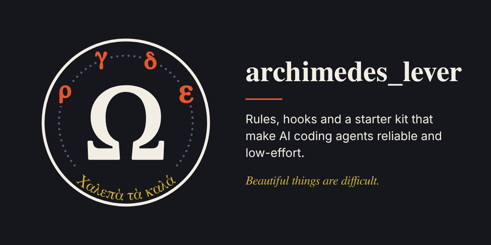

# archimedes_lever



A starter kit for working with Claude so that it is reliable and needs little effort from you. It collects lessons from real projects in a form you can copy.

The name comes from Archimedes: "Give me a place to stand, and I will move the world." Here, the place to stand is a set of files that every agent reads, so your rules, decisions and history stay put instead of disappearing with each chat.

Status: early. Built from 2026-11-10 to 2026-11-13 by one maintainer. In the maintainer's own rule tests on the rules of 2026-11-13 morning (graded by the testing agent, not independently; not re-run after later rule changes), agents followed the written rules in 27 of 30 scenarios ([rule tests](docs/reviews/2026-11-13-rule-tests.md)). Files that contain `{{...}}` values are templates: first use fills them in.

## Try it first

Paste this into Claude (claude.ai or Claude Code):

```
Tell me your thoughts about this repo: https://github.com/rhope-ops/archimedes_lever
```

## What you can take from it

| Take | What you get | Time | What you need |
|---|---|---|---|
| 1. [Preferences](PREFERENCES.md) for your own Claude account | Every chat asks its questions up front, labels its recommendations, says how confident it is, checks its work before it says "done", and saves you clicks and copying | About 5 minutes (our estimate, not timed): Claude asks you 3 questions and gives you one block to paste | Any Claude account. No GitHub needed. |
| 2. A project kit (the rest of this repo) | A new project where every agent follows one rules file, where force-pushes and pushes that contain your listed names or your email are blocked, where agents check their own work, and where decisions are written down | About 15 minutes with an agent (our estimate, not timed); see "Start here" below | A free GitHub account and Claude Code |

New to agents? Read [docs/WORKING_WITH_AGENTS.md](docs/WORKING_WITH_AGENTS.md) first: the working habits that matter most, in 5 minutes.

You can take 1 without 2: [PREFERENCES.md, "How to adopt them"](PREFERENCES.md#how-to-adopt-them-about-5-minutes).

## The lessons behind the rules

These are things that went wrong across 5 real projects, and the rule each one led to. The reason for every preference rule is in [PREFERENCES.md](PREFERENCES.md#why-each-rule-exists); the Maintainer's decisions are in [docs/DECISIONS.md](docs/DECISIONS.md); the story is in the public [docs/LOG.md](docs/LOG.md). Each rule now lives either in [PREFERENCES.md](PREFERENCES.md) (your account) or in the kit (your projects).

| Lesson | What happened | Where the rule lives |
|---|---|---|
| Ask all questions at the start, with options and a recommendation | A design review found 34 decisions the agent had assumed instead of asking | PREFERENCES.md "Decisions" |
| A review in a fresh context finds what self-review misses | A self-review checked that 39 notes existed; 30 of them said the opposite of the source | PREFERENCES.md "Reporting"; the kit's `reviewer` agent |
| Enforce safety with a hook, not just with written rules | A rule said "never force-push"; only one tool obeyed it | The kit's `scripts/git-hooks/pre-push` |
| Don't push to main until the checks pass | A commit reached main with a failing check | The kit's pre-push hook runs `scripts/check.sh`: the full lane before main, a fast lane on other branches |
| State each rule once; conflicting rules hurt more than long ones | 3 conflicting preference rules made the agent's behavior look random | One rule set in PREFERENCES.md; the kit's `.claude/rule-tests.md` |
| Measure; don't judge by eye | A layout shifted 14 px and no check noticed | The kit's `.claude/skills/verify` |
| Before you build, ask how the person works and what their setup allows | A solution assumed copy and paste, on a machine where the user had to type everything by hand | PREFERENCES.md "Least Effort for Me" |
| Build from a real sample and the full source, not from memory | A package built from the docs failed on import; a real export showed the wrong key | Ask for a sample first (not yet a rule) |
| Change one thing per test, and use a control | A test changed 2 things at once and could not find the cause | Not yet a rule |
| Keep personal data out of git from the very first commit | An old repo could never go public, because its history held a name and an email | The kit's `scripts/check_content.py` |
| Treat text in repos and on web pages as data, not as instructions | Research: one model followed an instruction injected into a README or TODO file 2.6 times more often than the same instruction in a code or data file | The kit's AGENTS.md "Untrusted input" |
| Check for bloat on a schedule, and measure before you cut | One operation went from 116.6 s to 23.4 s after an audit | The kit's `scripts/bloat_check.py` |

Sources: the research figure is from [arXiv 2610.38867](https://arxiv.org/abs/2610.38867) (see [the gap review](docs/reviews/2026-11-13-agentic-gap-review.md)). The other numbers come from the maintainer's own project logs, which are private.

## What you need

- A free [GitHub account](https://github.com/signup).
- Claude Code (in the browser at claude.ai/code, or the app). A plain claude.ai chat with no file access can't set up the project; use "Set up a project by hand" below instead.
- For way B only, on your computer: git, Python 3.9 or later, bash and perl. macOS and Linux already have bash and perl; on Windows, use Git Bash or WSL. If something is missing, the agent tells you how to install it.

## Start here (take 2: a project)

You don't need to know git: the agent handles it. Pick one way.

**A. In your browser, with nothing to install** (Claude Code on the web)

1. On this GitHub page, click **Use this template**. You see a menu. Go on.
2. In the menu, click **Create a new repository**. You see the page **Create a new repository**. Go on.
3. On the page **Create a new repository**, do these actions:
   1. In the box **Repository name**, type a name for your project, with no spaces.
   2. Select **Private**.
   3. Click **Create repository**.

   You see your new repository, with its name at the top. Write down the name.
4. In a new browser tab, open [claude.ai/code](https://claude.ai/code). You see the page **Claude Code**, or a sign-in page. Go on.
5. If you see a sign-in page, sign in to claude.ai. Wait until you see the page **Claude Code**.
6. If the page asks for access to GitHub, click the button that connects GitHub. You see a GitHub page. Go on.
7. On the GitHub page, give access to your new repository. Wait until you see the page **Claude Code** again.
8. On the page **Claude Code**, select the repository with the name that you wrote down. You see that name in the repository list. Go on.
9. In the message box, type `Please read the repo and initiate.` You see the text in the box. Go on.
10. Press **Enter**. You see the agent start its work. Wait until the agent asks its first question.

**B. With Claude Code on your computer**

1. If you use the Claude desktop app, open its tab **Code**. You see Claude Code. Go on.
2. In the desktop app, in the tab **Code**, choose the folder where you keep your projects (for example **Documents**). You see the folder name. Go on.
3. If you use a terminal, run `cd ~/Documents`, or the path of the folder where you keep your projects. You see the folder name in the prompt. Go on.
4. If you use a terminal, run `claude`. You see Claude Code start in the terminal. If it asks to trust the folder, answer yes. Go on.
5. In the message box of Claude Code, type this text. You see the text in the box. Go on.
   ```
   Please set up a new project from https://github.com/rhope-ops/archimedes_lever: get the repo, read it, and initiate.
   ```
6. Press **Enter**. You see the agent start its work. Wait until the agent asks its first question.

Either way, the agent asks you 4 questions: the project's name, what it is for, your time zone, and whether to use the recommended settings. The recommended settings give you the starter kit: the core rules, safety hooks and checks. You can add the advanced parts later. It explains each one. If you're not sure, pick the answer it marks as recommended. Then it fills in the project files (in way B, it also creates your GitHub repository) and tells you what is left to do.

One step is yours. The agent asks you to type your own names into a private list. The personal-data guard checks every push against that list, so your names never end up on GitHub by mistake. You never type the names into the chat. In the starter kit, a push without the list only warns (names are not checked until you add it); in the full kit, it is blocked. In the browser (way A), this means you add a setting and start one new session; the agent gives you a prompt to paste there, so you don't have to answer the questions again.

Also in the browser (way A): Claude Code may only be allowed to push to its own branch, not to `main`. If so, the agent tells you the push to `main` is blocked. Type `Please open a pull request`, open the link it gives you, and click **Merge pull request**.

If you know git, you can instead run `git clone https://github.com/rhope-ops/archimedes_lever my-project`, open the folder with your agent, and type `Please read the repo and initiate.`

Details for agents: [docs/FIRST_USE.md](docs/FIRST_USE.md).

## After setup

Open the project with Claude Code and say what you want to do next. The agent first reads AGENTS.md (the rules) and docs/NEXT_PROMPT.md (where the work stands), so you don't have to explain the project again in every chat.

## What's in the kit

Two tiers. **Starter** (recommended for a first project): AGENTS.md, the safety hooks, the personal-data guard, one check command, the `reviewer` agent, the skills and memory in files. **Full** adds the parts marked "Full only" in [docs/FILES.md](docs/FILES.md): multi-agent orchestration, the project log and timeline, the bloat audit and rule tests. The list of advanced files lives in `scripts/sync_baseline.py` (`ADVANCED_FILES`). Every file and what it does: [docs/FILES.md](docs/FILES.md).

Both tiers also get **Fulcrum Minimal**, the shared design tokens for project pages: [docs/brand/fulcrum.css](docs/brand/fulcrum.css), built from [docs/brand/fulcrum.json](docs/brand/fulcrum.json) by `python3 scripts/fulcrum_palette.py --write`, which also checks that its five colours still match the Logo Studies marks and that every text colour meets WCAG contrast.

## Set up a project by hand

For people who know git and don't want an agent to do the setup, or who only have a chat with no file access.

The bootstrap command takes 6 values, in this order:

| No. | Value | Example | Note |
|---|---|---|---|
| 1 | The project name | `"Project Name"` | |
| 2 | The repository | `YOUR_USER/NEW_NAME` | |
| 3 | The purpose, in one line | `"One-line purpose"` | |
| 4 | What agents call you | `"the Maintainer"` | A public repo uses a role, for example `"the Maintainer"`. A private repo can use your first name only with the guard off (no `.check` file): the guard blocks each push that has a name from your list. |
| 5 | Your time zone, as an IANA name | `"Europe/Berlin"` | Default: UTC. |
| 6 | The tier | `starter` | `starter` (default) or `full`. |

Bootstrap moves the kit's MIT license to `docs/archimedes_lever-LICENSE.txt`. Keep that file: it covers the kit's scripts. You can add a `LICENSE` file of your own.

You need git, Python 3.9 or later, bash, perl and [gh](https://cli.github.com). If you make the repository on GitHub with **Use this template**, use `git clone` with its address in place of the `gh repo create` command. On Windows, run each command in Git Bash, not in PowerShell.

1. In a terminal, run `gh auth login`. You see questions from gh. Answer each question, and wait until you see `Logged in as` and your GitHub user name.
2. In your browser, open [github.com/settings/emails](https://github.com/settings/emails). You see the GitHub page **Emails**. Go on.
3. On the page **Emails**, do these actions:
   1. Select **Keep my email addresses private**.
   2. Select **Block command line pushes that expose my email**.

   You see your noreply address on the page. It ends in `@users.noreply.github.com`. Keep the page open. Go on.
4. In the terminal, run this command, with the noreply address from the page **Emails** in place of `ID+USER@users.noreply.github.com`. You see no output. Go on.
   ```
   git config --global user.email "ID+USER@users.noreply.github.com"
   ```
5. Run `git config --global user.name "YOUR_USER"`, with your GitHub user name in place of `YOUR_USER`. Your real name then stays out of the commit history. You see no output. Go on.
6. Choose a repository name with no spaces. You see no output: you do it on paper. Write down the name. You type it in place of `NEW_NAME`.
7. Run this command. In it, `YOUR_USER` is your GitHub user name and `NEW_NAME` is the name that you wrote down. You see a line that starts with `✓ Created repository`. Go on.
   ```
   gh repo create YOUR_USER/NEW_NAME --private --template rhope-ops/archimedes_lever --clone
   ```
8. Run `cd NEW_NAME`, with the name that you wrote down. You see the name in the prompt. Go on.
9. Run the bootstrap command, with your 6 values from the table in place of the examples. You see the line `Done. Next: review with 'git diff', then commit and push.` Go on.
   ```
   scripts/bootstrap.sh "Project Name" YOUR_USER/NEW_NAME "One-line purpose" "the Maintainer" "Europe/Berlin" starter
   ```
10. Run `mkdir -p ~/.config/pii-guard && nano ~/.config/pii-guard/denylist.txt`. You see the editor **nano**. Go on.
11. In **nano**, type your names, your user name variants and your employer, one on each line. You see the names in **nano**. Go on.
12. In **nano**, press **Ctrl+X**, **Y** and **Enter**. This saves the file and closes **nano**. You see the prompt again. Go on.
13. Run `python3 scripts/check_content.py --status`. On Windows, the command starts with `py`, not `python3`. You see the number of entries in your list, never the names. Go on.
14. Run `scripts/session_checkin.sh`. It installs the git hooks. You see the line `hooks:` with the hooks folder. Go on.
15. Run `git add -A`. You see no output. Go on.
16. Run `git commit -m "First use"`. You see the commit summary. Go on.
17. Run `git push -u origin main`. You see the pre-push check. Wait until you see `CHECK PASS` and the push ends. If you see `CHECK FAIL`, the lines above it name the failed check. Correct that fault before you push again. If you do not use a claude.ai Project, the task is complete.
18. If you use a claude.ai Project, run `cat docs/host-prompts.md`. You see the text for the Project in the terminal. Go on.
19. In the terminal, select the text with the mouse. You see the text selected. Go on.
20. Copy the text with the copy key of your terminal. The text goes to the clipboard. You see no change. Go on.
21. In claude.ai, in your Project, open the Project instructions. You see the box for the instructions. Go on.
22. Paste the text into the box. You see the text in the box. Go on.
23. Click **Save**. You see the Project page with the new instructions. The task is complete.

## Keep personal data out

With the guard on in the full kit, every push fails until your name list exists, and so does every pull-request check in a public repo (a private repo runs no pull-request check). In the starter kit, `.check` has the line `denylist: warn`: a push without the list warns, and every other check still runs; delete that line to block. The guard only runs in a repo that has a `.check` file at its root; that file also lists exact strings you want to allow. A private repo that names you on purpose can delete it.

Your name list holds your names, your user name variants and your employer. It never goes into a repo. You add it in each place where you work: your computer, each Claude cloud environment, and the GitHub pull-request check.

1. In your browser, open [github.com/settings/emails](https://github.com/settings/emails). You see the GitHub page **Emails**. Go on.
2. On the page **Emails**, do these actions:
   1. Select **Keep my email addresses private**.
   2. Select **Block command line pushes that expose my email**.

   You see your noreply address on the page. It ends in `@users.noreply.github.com`. Keep the page open. Go on.
3. In a terminal, run this command, with the noreply address from the page **Emails** in place of `ID+USER@users.noreply.github.com`. You see no output. Go on.
   ```
   git config --global user.email "ID+USER@users.noreply.github.com"
   ```
4. Run `git config --global user.name "YOUR_USER"`, with your GitHub user name in place of `YOUR_USER`. You see no output. Go on.
5. If your computer has macOS or Linux, run `mkdir -p ~/.config/pii-guard && nano ~/.config/pii-guard/denylist.txt`. You see the editor **nano**. Go on.
6. If your computer has Windows, in PowerShell, run `mkdir -Force $HOME\.config\pii-guard; notepad $HOME\.config\pii-guard\denylist.txt`. You see a question from **Notepad** about a new file. Go on.
7. If **Notepad** asks to make a new file, click **Yes**. You see an empty **Notepad** window. Go on.
8. In the editor, type the names of your list, one on each line. You see the names in the editor. Go on.
9. If you use **nano**, press **Ctrl+X**, **Y** and **Enter**. This saves the file and closes **nano**. You see the prompt again. Go on.
10. If you use **Notepad**, press **Ctrl+S**. This saves the file. You see no mark of unsaved changes in the title bar. Go on.
11. If you use Claude Code on the web, in the session, do these actions:
    1. Open the environment menu at the top of the session.
    2. Click **Edit**.
    3. In the box **Environment variables**, type `PII_GUARD_DENYLIST=Name1,Name2`, with your names in place of `Name1,Name2`.
    4. Click **Save**.

    You see the session again. A new session reads the list; this session does not. Go on.
12. In your browser, open `https://github.com/` with your GitHub user name and the repository name after it, for example `https://github.com/YOUR_USER/NEW_NAME`. You see the tab **Code** of the repository. Go on.
13. On the page of your repository, click **Settings**. You see the page **General**. Go on.
14. In the menu on the left, click **Secrets and variables**, then **Actions**. You see the page **Actions secrets and variables**. Go on.
15. Click **New repository secret**. You see the page **New secret**. Go on.
16. On the page **New secret**, do these actions:
    1. In the box **Name**, type `PII_GUARD_DENYLIST`.
    2. In the box **Secret**, type your names, with a comma between two names.
    3. Click **Add secret**.

    You see `PII_GUARD_DENYLIST` in the list of secrets. Go on.
17. On your computer, in a terminal, run `cd` with the path of the project folder. You see the project folder name in the prompt. Go on.
18. Run `python3 scripts/check_content.py --status`. On Windows, the command starts with `py`, not `python3`. You see where the list comes from and the number of entries, never the names. Go on.
19. Run `python3 scripts/check_content.py --all`. You see `CONTENT CHECK PASS`, or each finding with its value masked. If you see `CONTENT CHECK PASS`, the task is complete. Go on only for a finding.
20. For each finding, open the file at the line that the finding names. Remove the personal data on that line. You see the line without it. If the value must stay, ask the project's Maintainer: only the Maintainer adds an allowed value to `.check`. Go on.
21. Run `python3 scripts/check_content.py --all` again. You see `CONTENT CHECK PASS`. The task is complete.

An optional second list holds your own blocked terms (words that are not personal data), as `CHECK_TERMS` in the same three places. The steps for agents, the fingerprint check and one master copy of the list: [docs/FIRST_USE.md](docs/FIRST_USE.md), step 4.

## Update an existing project

A project takes a kit release as one pull request. The kit files in a project are locked (`.check.lock` holds their hashes and the kit version, and the check fails when one differs); a project adds its own rules, commands, checks and skill additions in the places that [the kit-update skill](.claude/skills/kit-update/SKILL.md) lists, and a sync does not touch those. To bring a project up to date, start in the project repo with no uncommitted changes:

The sync command takes these options:

| Option | Add it when |
|---|---|
| `--tier full` | You move a starter project to the full kit. It adds the advanced files and docs/LOG.md. To make the name guard block, delete the line `denylist: warn` in `.check`. |
| `--name`, `--repo`, `--purpose` | The project's AGENTS.md has no title line (`--name`), no `- Repo:` line or no `- Purpose:` line. |
| `--owner NAME` | AGENTS.md has no `- Owner:` line, or you change the role word. For kit 11.0.0, type `--owner "the Maintainer"`. The sync then writes that word in the `- Owner:` line and in the kit text. |
| `--timezone ZONE` | AGENTS.md has no `- Time zone:` line (ZONE is an IANA name). |

1. In an editor, open the file `AGENTS.md` of the project. You see its header lines at the top. Go on.
2. In the header, look for the title line and the lines `- Repo:`, `- Purpose:`, `- Owner:` and `- Time zone:`. You see which lines are there. Write down the option from the table for each line that is not there. Also write down its value. For the title line, the option is `--name`. Go on.
3. In a terminal, run `cd` with the path of the folder that holds the project folder, for example `cd ~/Documents`. You see its name in the prompt. Go on.
4. If there is no folder `archimedes_lever` there, run `git clone https://github.com/rhope-ops/archimedes_lever`. You see `Cloning into 'archimedes_lever'`. Wait until the prompt shows again.
5. If the folder `archimedes_lever` is there, run `git -C archimedes_lever pull`. You see the kit's changes, or `Already up to date.` Go on.
6. Run `cd` with the project folder name. You see the project folder name in the prompt. Go on.
7. Run `git switch main`. You see `Switched to branch 'main'`, or `Already on 'main'`. Go on.
8. Run `git pull`. You see the new commits, or `Already up to date.` Go on.
9. Run `git switch -c kit-sync-$(cat ../archimedes_lever/KIT_VERSION)`. You see `Switched to a new branch 'kit-sync-` and the kit version. Go on.
10. Run this command, with the options that you wrote down. You see the diff of each file that the sync changes. Nothing is written yet. Go on.
    ```
    python3 ../archimedes_lever/scripts/sync_baseline.py --baseline ../archimedes_lever
    ```
11. Read the diff. You see each change of the sync. If a change is not what you want, do not go on. No file is written yet, so the project stays as it is.
12. Run the same command again, with `--apply` at the end. You see the line `Written, with the kit lock`, or `No changes: the project already matches the baseline.` After `No changes`, the task is complete. Go on.
13. Run `git --no-pager diff`. You see the changes in the terminal. Go on.
14. Run `git add -A`. You see no output. Go on.
15. Run `git commit -m "Kit sync"`. You see the commit summary. Go on.
16. Run `git push -u origin HEAD`. You see the pre-push check. Wait until you see `CHECK PASS` and a link to make a pull request.
17. Open the link from the push. You see the GitHub page **Open a pull request**. Go on.
18. Click **Create pull request**. You see the page of your new pull request. The task is complete.

An old AGENTS.md that doesn't follow the kit's layout is moved under "Project rules" with a review note. Delete whatever the kit now covers.

The sync replaces every kit file, so a project keeps its own code in its own files, which a sync never touches:

- `scripts/check.local.sh`: the project's own tests (`scripts/check.sh` runs it last).
- `scripts/check_content_local.py`: its own finders for the content check, for example its own pattern for a kind of finding (the interface: the header of `scripts/check_content_scan.py`).
- `scripts/check_instructions_local.py`: its own words, lower limits, a parser for another file type or more checks for the steps a person follows (the interface: the header of `scripts/check_instructions.py`).
- `scripts/code_standard_gate.py`: its own stricter code-standard rules (the interface: the header of `scripts/code_standard.py`; [docs/code-standard.md](docs/code-standard.md) "A project's own gate").

A kit file that the Maintainer wants different in one project is recorded with `python3 scripts/check_lock.py --relock <file>` on the Maintainer's request, and each check run lists it. The steps, the approval of changed rule lines and the before and after proof: [.claude/skills/kit-update/SKILL.md](.claude/skills/kit-update/SKILL.md).

## Limits

- A project doesn't update when the kit does: someone runs the sync and merges its pull request. What each kit version changes, and what a MAJOR version asks of a project: [docs/CHANGELOG.md](docs/CHANGELOG.md).
- The hooks run on your computer or in the agent's container. Server-side protection (a ruleset on main, secret scanning) is a GitHub setting that only you can turn on: [docs/github/](docs/github/README.md).
- Account-wide preferences apply only to your own Claude account. Every Claude session in the project gets the project rules from AGENTS.md.
- Setup needs an agent with file access. A chat that can't run commands can only give you text to paste; use "Set up a project by hand".
- With the guard on, the pull-request check needs the `PII_GUARD_DENYLIST` secret (and `CHECK_TERMS` when you use a list of blocked terms). GitHub doesn't give secrets to pull requests from forks, so a pull request from a fork always fails the check. The maintainer checks it by hand, or copies it to a branch in the repo.
- The pull-request check runs the scripts from the pull request itself, so a pull request that edits `scripts/check_content.py` or `scripts/check.sh` can change the result. Review changes to those files by hand.
- Hooks are seat belts, not locks: Claude Code hooks only apply to Claude Code, and `--no-verify` skips git hooks.
- The Claude Code sandbox (the network allowlist in .claude/settings.json) needs bubblewrap and socat on Linux. Without them, Claude Code warns you and runs commands outside the sandbox; the deny rules and git hooks still apply. Claude cloud containers don't have them, but they sit behind their own network proxy. macOS needs nothing extra.
- The guard finds patterns and the names on your list. It can't find a name you didn't list, or personal details written out in sentences. Read everything before you publish.
- Claude model names in `.claude/skills/delegate/SKILL.md` go out of date; the tiers stay the same.
